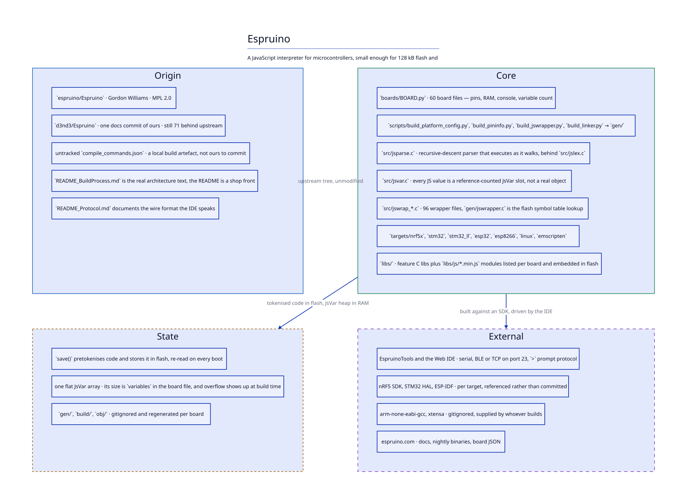

# Espruino

A JavaScript interpreter that runs on the microcontroller itself: tokenise and execute on the device, in as little as 128 kB flash and 8 kB RAM.

Read it left to right:

- **This fork holds no source changes of ours.** `d3nd3/Espruino` mirrors `espruino/Espruino` and is still 71 commits behind `upstream/master`; the only commits of our own are this document, its diagram and the renderer, and the only local dirt is an untracked `compile_commands.json` from somebody's build.
- **There is no compiler back end to look for.** `src/jsparse.c` is a recursive-descent parser that executes as it walks the source, and the lexer in front of it is `src/jslex.c`. What looks like bytecode is the *pretokenised* form: `save()` writes a tokenised copy of your code to flash (the `JSF_PRETOKENISE` flag on that block) so a cold boot resumes without re-parsing text.
- **Memory is a build-time decision, not a runtime one.** Every JS value is a reference-counted JsVar slot in one flat array, and the board file's `variables` number sizes that array. Get it wrong and the build or the linker complains, which is why `boards/BANGLEJS2.py` carries a comment about how much stack the current number leaves.
- **A board is a Python file, not C.** `boards/<BOARD>.py` (60 of them) describes pins, RAM, console and variable count, and four scripts in `scripts/` turn it into `gen/platform_config.h`, `gen/jspininfo.c`, `gen/jswrapper.c` and `gen/linker.ld`. `gen/`, `build/` and `obj/` are all gitignored, so the C you read is the half that is not generated.
- **`require()` is frequently flash.** The board file lists `libs/js/*.min.js` modules (`JSMODULESOURCES`), so on a Bangle.js the graphics and locale modules are already inside the firmware image, while on a smaller board the same call has to upload the source first.
- **Bangle.js is just one of the targets.** `targets/nrf5x`, `stm32`, `stm32_ll`, `esp32`, `esp8266`, `linux` and `emscripten` each provide `jshardware.c`; the toolchain (arm-none-eabi-gcc for the watches) is expected on your PATH and is not in the repo.

Diagram source: [`docs/system.d2`](docs/system.d2) · renderer: [`scripts/render-diagram.sh`](scripts/render-diagram.sh).
